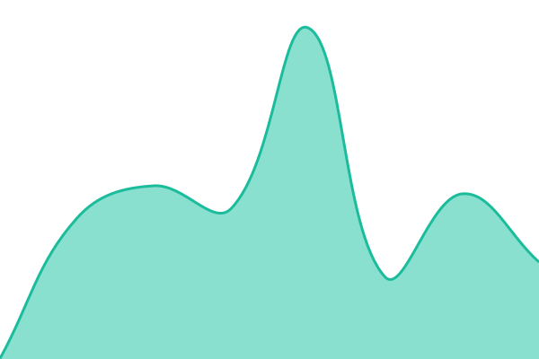
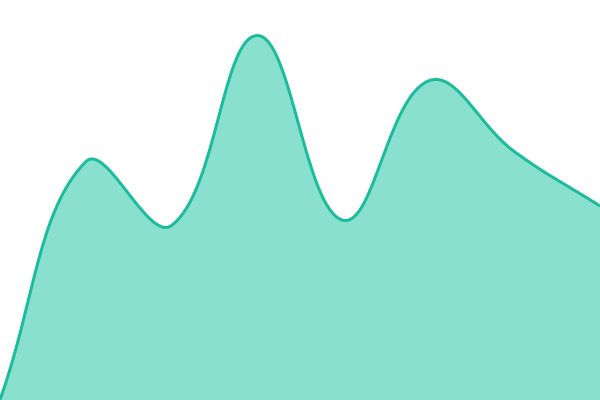

# [📈 Aktuálny stav](https://status.msgweb.io): <!--live status--> **Všetky služby bežia**

This repository contains the open-source uptime monitor and status page for [msg-life-slovakia](https://status.msgweb.io), powered by [Upptime](https://github.com/upptime/upptime).

With [Upptime](https://upptime.js.org), you can get your own unlimited and free uptime monitor and status page, powered entirely by a GitHub repository. We use [Issues](https://github.com/msg-life-slovakia/status/issues) as incident reports, [Actions](https://github.com/msg-life-slovakia/status/actions) as uptime monitors, and [Pages](https://status.msgweb.io) for the status page.

## [📈 Live Status](https://demo.upptime.js.org): <!--live status--> **Všetky služby bežia**

<!--start: status pages-->
<!-- This summary is generated by Upptime (https://github.com/upptime/upptime) -->
<!-- Do not edit this manually, your changes will be overwritten -->
<!-- prettier-ignore -->
| URL | Status | History | Response Time | Uptime |
| --- | ------ | ------- | ------------- | ------ |
|  [Brain API](https://brain.msgweb.io/api/health) | V prevádzke | [brain-api.yml](https://github.com/msg-life-slovakia/status/commits/HEAD/history/brain-api.yml) | 

 708ms
     
 | 

<a href="https://status.msgweb.io/history/brain-api">100.00%</a>
    

|  [Brain databáza](https://brain.msgweb.io/api/health) | V prevádzke | [brain-db.yml](https://github.com/msg-life-slovakia/status/commits/HEAD/history/brain-db.yml) | 

 609ms
     
 | 

<a href="https://status.msgweb.io/history/brain-db">100.00%</a>
    

|  [Brain integrácie (GSC, GA4, Rank Tracker)](https://brain.msgweb.io/api/health) | V prevádzke | [brain-integrations.yml](https://github.com/msg-life-slovakia/status/commits/HEAD/history/brain-integrations.yml) | 

 559ms
     
 | 

<a href="https://status.msgweb.io/history/brain-integrations">100.00%</a>
    

|  [Brain chat (frontend)](https://brain.msgweb.io/) | V prevádzke | [brain-frontend.yml](https://github.com/msg-life-slovakia/status/commits/HEAD/history/brain-frontend.yml) | 

 432ms
     
 | 

<a href="https://status.msgweb.io/history/brain-frontend">100.00%</a>
    

|  [Brain external API v1](https://brain.msgweb.io/api/v1/data) | V prevádzke | [brain-api-v1.yml](https://github.com/msg-life-slovakia/status/commits/HEAD/history/brain-api-v1.yml) | 

 473ms
     
 | 

<a href="https://status.msgweb.io/history/brain-api-v1">100.00%</a>
    

|  [Brain MCP endpoint](https://brain.msgweb.io/api/v1/mcp) | V prevádzke | [brain-mcp.yml](https://github.com/msg-life-slovakia/status/commits/HEAD/history/brain-mcp.yml) | 

 421ms
     
 | 

<a href="https://status.msgweb.io/history/brain-mcp">100.00%</a>
    

|  [msg-life.sk](https://msg-life.sk/) | V prevádzke | [msg-life-sk.yml](https://github.com/msg-life-slovakia/status/commits/HEAD/history/msg-life-sk.yml) | 

 418ms
     
 | 

<a href="https://status.msgweb.io/history/msg-life-sk">100.00%</a>
    

|  [msgprogramator.sk](https://msgprogramator.sk/) | V prevádzke | [msgprogramator-sk.yml](https://github.com/msg-life-slovakia/status/commits/HEAD/history/msgprogramator-sk.yml) | 

 431ms
     
 | 

<a href="https://status.msgweb.io/history/msgprogramator-sk">100.00%</a>
    

|  [msgtester.sk](https://msgtester.sk/) | V prevádzke | [msgtester-sk.yml](https://github.com/msg-life-slovakia/status/commits/HEAD/history/msgtester-sk.yml) | 

 336ms
     
 | 

<a href="https://status.msgweb.io/history/msgtester-sk">100.00%</a>
    

|  [ittester.sk](https://ittester.sk/) | V prevádzke | [ittester-sk.yml](https://github.com/msg-life-slovakia/status/commits/HEAD/history/ittester-sk.yml) | 

 371ms
     
 | 

<a href="https://status.msgweb.io/history/ittester-sk">100.00%</a>
    

|  [msg-life.sk sitemap](https://msg-life.sk/sitemap.xml) | V prevádzke | [msg-life-sitemap.yml](https://github.com/msg-life-slovakia/status/commits/HEAD/history/msg-life-sitemap.yml) | 

 1277ms
     
 | 

<a href="https://status.msgweb.io/history/msg-life-sitemap">100.00%</a>
    

|  [msgprogramator.sk sitemap](https://msgprogramator.sk/sitemap.xml) | V prevádzke | [msgprogramator-sitemap.yml](https://github.com/msg-life-slovakia/status/commits/HEAD/history/msgprogramator-sitemap.yml) | 

 1230ms
     
 | 

<a href="https://status.msgweb.io/history/msgprogramator-sitemap">100.00%</a>
    

|  [msgtester.sk sitemap](https://msgtester.sk/sitemap.xml) | V prevádzke | [msgtester-sitemap.yml](https://github.com/msg-life-slovakia/status/commits/HEAD/history/msgtester-sitemap.yml) | 

 946ms
     
 | 

<a href="https://status.msgweb.io/history/msgtester-sitemap">100.00%</a>
    

|  [ittester.sk sitemap](https://ittester.sk/sitemap.xml) | V prevádzke | [ittester-sitemap.yml](https://github.com/msg-life-slovakia/status/commits/HEAD/history/ittester-sitemap.yml) | 

 1034ms
     
 | 

<a href="https://status.msgweb.io/history/ittester-sitemap">100.00%</a>
    

<!--end: status pages-->

[**Visit our status website →**](https://status.msgweb.io)

## 📄 License

- Powered by: [Upptime](https://github.com/upptime/upptime)
- Code: [MIT](./LICENSE) © [Anand Chowdhary](https://anandchowdhary.com)
- Data in the `./history` directory: [Open Database License](https://opendatacommons.org/licenses/odbl/1-0/)
